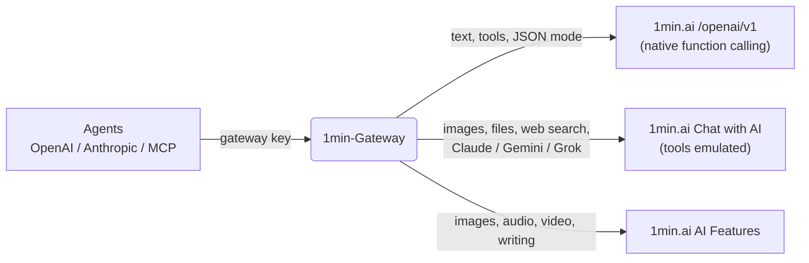

# 1min-Gateway

[](https://github.com/bidabil/1min-Getway/actions/workflows/ci.yml)
[](LICENSE)

**Use [1min.ai](https://1min.ai) as the LLM of your AI agents.** 1min-Gateway exposes your
1min.ai account through the APIs agents already speak:

| Interface | Endpoints | Works with |
|-----------|-----------|------------|
| **OpenAI** | `/v1/chat/completions`, `/v1/models`, `/v1/images/*`, `/v1/audio/*`, `/v1/files` | OpenAI SDK, LangChain, CrewAI, AutoGen, LlamaIndex, n8n, Open WebUI… |
| **Anthropic** | `/v1/messages`, `/v1/messages/count_tokens` | Anthropic SDK, agents written for Claude |
| **MCP** | `/mcp` (streamable HTTP) | Claude Desktop/Code, Cursor, any MCP client |
| **1min.ai features** | `/v1/features/{type}` | Every 1min.ai tool: video, music, writing, image tools, YouTube… |

Your 1min.ai key stays on the server. Each agent gets its own revocable gateway key.

## How it works



* **Native first.** Requests go to 1min.ai's OpenAI-compatible API (real function calling,
  streaming, `response_format`, reasoning models) whenever the model is listed there.
* **Everything else** goes to the *Chat with AI* API: image and file input, web search, and
  models such as Claude, Gemini or Grok. The gateway sends the whole conversation on every call
  (stateless, like OpenAI) and emulates tool calls for these models.
* **Model lists come from 1min.ai** (`/openai/v1/models` and the public catalog
  `/models?feature=UNIFY_CHAT_WITH_AI`), cached for 10 minutes. Claude names used by agents
  (`claude-haiku-4-5-20251001`) are mapped to 1min.ai's ids (`us.anthropic.claude-haiku-4-5-20251001-v1:0`).
* **Sampling parameters** that a model rejects (e.g. `temperature` on reasoning models) are dropped,
  and output limits are capped to the model maximum, so agent frameworks work with defaults.

## Quick start

```bash
cp .env.example .env
# 1. put your 1min.ai key in ONE_MIN_API_KEY
# 2. create a key for each agent and add the printed entry to GATEWAY_API_KEYS
docker compose run --rm gateway python -m gateway.cli create-key my-agent
docker compose up -d
curl http://127.0.0.1:5001/ready
```

Without Docker (Python 3.12+): `make install`, `make key NAME=my-agent`, `make dev`.

On a fresh server: `curl -fsSL https://raw.githubusercontent.com/bidabil/1min-Getway/main/deploy.sh | bash`.
The gateway listens on `127.0.0.1` only: put a TLS reverse proxy (Caddy, Traefik, nginx) in front of
it before exposing it to other machines.

## Connect your agents

```python
from openai import OpenAI

client = OpenAI(base_url="http://127.0.0.1:5001/v1", api_key="gw-...", max_retries=0)
reply = client.chat.completions.create(
    model="gpt-4o-mini",
    messages=[{"role": "user", "content": "Hello"}],
)
```

```python
import anthropic

client = anthropic.Anthropic(base_url="http://127.0.0.1:5001", api_key="gw-...", max_retries=0)
message = client.messages.create(
    model="claude-sonnet-4-6",
    max_tokens=1024,
    messages=[{"role": "user", "content": "Hello"}],
)
```

MCP clients: URL `http://127.0.0.1:5001/mcp`, header `Authorization: Bearer gw-...`.

> Set `max_retries=0`: 1min.ai bills every generation, and a retried POST is a new generation.

Model names: `GET /v1/models` lists native models, the *Chat with AI* models and your aliases
(field `vision`: whether the model accepts images).
Map the names your agents send with `MODEL_ALIASES`, e.g. `claude-*=gpt-5.1` to run a Claude-based
agent on a native model with real function calling. Append `:online` to a model name
(`gpt-4o-mini:online`) to enable 1min.ai web search.

See [docs/API_PARAMETERS.md](docs/API_PARAMETERS.md) for every endpoint and parameter, and
[docs/GUIDE-AGENTS-FR.md](docs/GUIDE-AGENTS-FR.md) for a French setup guide with agent examples.

## Configuration

All settings are environment variables (see [.env.example](.env.example)). The essentials:

| Variable | Purpose | Default |
|----------|---------|---------|
| `ONE_MIN_API_KEY` | Your 1min.ai API key (**required**) | – |
| `GATEWAY_API_KEYS` | Agent keys as `name:sha256[:rpm]` (**required**) | – |
| `RATE_LIMIT_RPM` | Requests per minute per agent key (0 = off) | `60` |
| `MODEL_ALIASES` | `client-model=1min-model` mappings, wildcards allowed | – |
| `LEGACY_CHAT_MODELS` | Extra Chat with AI model ids, in addition to 1min.ai's catalog | – |
| `METRICS_TOKEN` | Enables `/metrics` (Prometheus, Bearer token) | disabled |
| `MCP_ENABLED` / `MCP_ALLOWED_HOSTS` | MCP server and its allowed host names | `true` / – |
| `DOCS_ENABLED` | Serve `/docs` (OpenAPI UI) | `false` |

## Security

* Agents authenticate with gateway keys; only their SHA-256 digests are configured.
* Every endpoint except `/health`, `/ready`, `/v1/version` and `/` requires a key; `/metrics` needs `METRICS_TOKEN`.
* The gateway never downloads URLs supplied by clients: image URLs are passed to 1min.ai, inline
  images are uploaded through the 1min.ai Asset API. Only result files returned by 1min.ai are
  downloaded (HTTPS, no redirects, public addresses only, size-capped).
* Logs are JSON and never contain prompts, completions or keys.
* The container runs as a non-root user with a read-only filesystem and no capabilities.

## Limitations

* 1min.ai's OpenAI-compatible API is text-only, limited to 200 messages / 100,000 characters per
  request and 60 requests per minute per account. Image/file input therefore uses the Chat with AI
  API, where tool calls are emulated (reliable with strong models, not guaranteed).
* Token usage for the Chat with AI API is estimated (characters / 4).
* 1min.ai returns one signed URL per generated image set: with `n > 1` the other images are
  returned as asset keys.
* Rate limits and caches are in memory: each worker or replica keeps its own.
* Embeddings and the OpenAI Responses API are not offered by 1min.ai and are not emulated.

## Development

```bash
make install     # dependencies (requirements-dev.txt)
make check       # ruff + mypy --strict + tests with coverage
```

Architecture (hexagonal): `src/gateway/domain` (models and pure rules), `application` (use cases and
ports), `infrastructure` (1min.ai adapters, security, observability), `interfaces` (HTTP APIs, MCP).
Tests run hermetically against an in-memory fake of 1min.ai.

## License

MIT – Copyright (c) 2026 Billel Attafi
